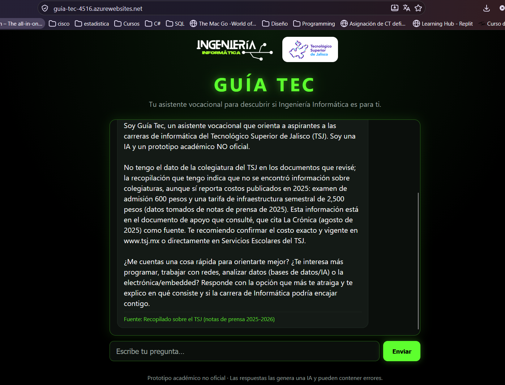
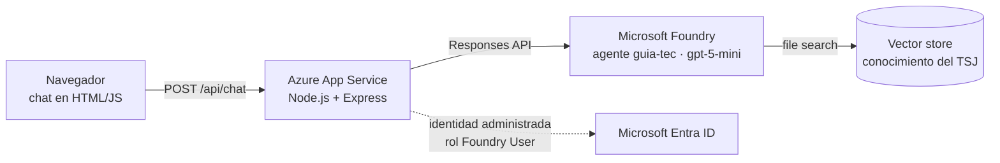

# Guía Tec: asistente vocacional para Ingeniería Informática del TSJ

Chatbot web que orienta a aspirantes que se preguntan si Ingeniería Informática es para ellos. Responde dudas sobre el Tecnológico Superior de Jalisco (TSJ) usando un agente de Microsoft Foundry y una pequeña base de conocimiento, y siempre avisa que es una IA y de qué documento sacó cada dato.

**Aplicación en línea:** https://guia-tec-4516.azurewebsites.net
(corre en el plan gratuito de Azure; si lleva un rato sin visitas, la primera carga puede tardar unos segundos)

**Autores:** 
- Martha Leticia Colmenares Zepeda
- Juan Carlos García Sepúlveda
- José Luis Cobián Hermosillo

**Proyecto integrador:** (continuación del proyecto de la fase 1)

> Es un prototipo académico. No es un canal oficial del TSJ.



*Guía Tec en la URL pública. Preguntamos por la colegiatura: como ese dato no está en su base de conocimiento, lo dice abiertamente en lugar de inventarlo, comparte lo que sí tiene (con su año), recomienda confirmarlo en www.tsj.mx y muestra la fuente al pie.*

---

## 1. De qué viene este proyecto

En la fase 1 analizamos los diferentes de cada uno de ellos, por lo cual decidimos seguir con el problema de la fase 1 entregado por Jose Luis Cobián Hermosillo que consistia en una institución educativa ficticia, Rinosoft, donde se abarcaban tres problemas comunes en las escuelas: la captación de alumnos, la permanencia y la deserción. Para la captación generamos un agente de admisiones llamado Alumno-Bot con Microsoft 365 Copilot que todavia en esa parte del proyecto no se tenia claro su funcionammiento o como se iba a implementar.

Para este proyecto se retomó esa misma línea (la captación) y la llevamos a Microsoft Foundry, ahora con un contexto real: el Tecnológico Superior de Jalisco y su carrera de Ingeniería Informática que es una institución ligada a nuestras labores. Rinosoft desaparece y el agente pasa a llamarse **Guía Tec**.

## 2. El problema

Mucha gente que termina la preparatoria no sabe bien qué estudiar, o tiene ideas vagas de lo que es la carrera de informática ("¿es solo programar?", "¿me sirve si lo mío es armar computadoras?"). Las áreas de admisión no siempre alcanzan a atender cada duda a tiempo, y la información útil (qué carreras hay, dónde, cómo se inscribe uno, cuánto cuesta) está repartida en notas, redes y páginas.

## 3. Qué hace la solución

- Conversa con el aspirante, le pregunta por sus gustos (programar, redes, datos, electrónica) y le orienta sobre si la carrera podría encajar con él, sin presionarlo ni prometerle nada.
- Responde datos del TSJ (carreras de computación, unidades, proceso de admisión, costos publicados) a partir de una base de conocimiento propia.
- Cuando el dato sale de esa base, **muestra la fuente** debajo de la respuesta.
- Cuando no tiene el dato (becas, colegiatura, plan de estudios), **lo dice** y manda al aspirante al sitio oficial o a Servicios Escolares.
- Mantiene el contexto de la conversación: si el aspirante dice que le gustan los videojuegos y luego pregunta "¿eso me sirve?", entiende a qué se refiere.

NOTA: En este momento esta llenado solo con información vaga y que se obtuvo a traves de los sitios

## 4. Cómo está hecho

Se siguio las instrucciones que nos dejo el tutorial del maestro.



El navegador nunca habla directo con Foundry. Solo habla con el servidor de la app, y el servidor se comunica con el agente. En Azure, el servidor se autentica con una **identidad administrada**, así que no hay claves ni tokens guardados en el código ni en el repositorio.

**Tecnologías**
- Azure App Service (Linux, Node.js 24 LTS), plan gratuito F1
- Microsoft Foundry: proyecto, despliegue del modelo `gpt-5-mini` y agente de tipo *prompt*
- File search (vector store de Foundry) para la base de conocimiento
- Microsoft Entra ID (identidad administrada) para la autenticación entre la app y Foundry
- Express 5, `@azure/ai-projects` 2.x y `@azure/identity`
- Frontend en HTML, CSS y JavaScript sin frameworks

### Flujo de una pregunta
1. El navegador envía el mensaje al servidor.
2. El servidor valida que tenga entre 1 y 2000 caracteres (si no, responde 422).
3. Crea una conversación en Foundry la primera vez y reutiliza su identificador en los mensajes siguientes.
4. El agente busca en la base de conocimiento, redacta la respuesta y el servidor devuelve el texto junto con la lista de documentos que usó.
5. Si Foundry falla, el usuario ve un mensaje genérico (502) y los detalles solo quedan en el registro del servidor.

## 5. La base de conocimiento

Está en [`conocimiento/tsj-informatica.md`](conocimiento/tsj-informatica.md) y se sube a Foundry con `npm run load-knowledge`. Se armo con información pública de notas de prensa (La Crónica y Publimetro, 2025 y 2026) e incluye:

- Las 16 unidades académicas del TSJ y el campus virtual.
- La lista de programas de 2025 y las cifras de 2026; las carreras de computación (Ingeniería en Sistemas Computacionales, Ingeniería en Informática y Maestría en Sistemas Computacionales).
- Los pasos del proceso de admisión de 2025 y los costos publicados entonces (examen de 600 pesos y tarifa de infraestructura semestral de 2,500).

Cada dato indica su fuente y su fecha. Lo que **no** se pudo encontrar quedó anotado como faltante en el mismo documento: plan de estudios, perfiles de ingreso y egreso, becas, colegiatura, fechas de 2026, documentos requeridos y datos de contacto. El sitio oficial del TSJ no permite leer ese contenido de forma automática. Por eso el agente está configurado para decir "no lo tengo" en esos casos.

## 6. IA responsable

Las reglas están escritas en las instrucciones del agente ([`scripts/create-agent.js`](scripts/create-agent.js)) y en [`.github/copilot-instructions.md`](.github/copilot-instructions.md). Esto es lo que cumple hoy cada principio y lo que todavía falta:

| Principio | Qué se hizo | Evidencia | Pendiente |
|---|---|---|---|
| **Equidad** | El agente tiene la instrucción de tratar igual a cualquier aspirante, sin suponer género, origen ni nivel. | Instrucciones del agente. | No hice una prueba comparativa con distintos perfiles. |
| **Confiabilidad y seguridad** | Responde solo con lo que encuentra en la base de conocimiento; si falta el dato, lo dice y remite al sitio oficial. Avisa cuando un dato es de 2025 y debe confirmarse. | La captura de arriba (colegiatura) y las pruebas de la sección 7. | Falta el plan de estudios oficial. |
| **Privacidad y seguridad** | No se piden datos personales. La app usa identidad administrada, sin claves en el código; `.env` y los materiales del curso no se suben a Git ni a Azure. | `.gitignore`, `.env.example` y el rol Foundry User asignado a la app. | No uso Key Vault porque no hay secretos que guardar; si se añadieran, irían ahí. |
| **Inclusión** | Diseño responsivo (se ve bien desde 360 px de ancho), contraste alto y campos con etiqueta para lectores de pantalla. | Interfaz en [`public/`](public/). | **No hay entrada por voz todavía.** |
| **Transparencia** | El primer mensaje dice que es una IA y un prototipo no oficial; cada respuesta basada en el conocimiento muestra su fuente; el pie de página advierte que puede equivocarse. | Captura de arriba. | |
| **Rendición de cuentas** | El agente solo orienta: no decide nada y siempre remite a Servicios Escolares o a www.tsj.mx para trámites. | Instrucciones del agente. | **No hay un flujo de seguimiento por una persona del plantel** (ver sección 9). |

## 7. Pruebas que se hicieron 

| Prueba | Resultado |
|---|---|
| `GET /health` | `{"status":"ok"}` |
| Mensaje vacío, solo espacios o de más de 2000 caracteres | 422 con un mensaje claro |
| Una pregunta y un seguimiento en la misma conversación | El seguimiento mantiene el contexto |
| "¿Cuánto cuesta el examen de admisión del TSJ?" | 600 pesos (dato de 2025) con la fuente al pie |
| "¿Qué carreras de computación hay y en qué ciudades hay unidades?" | Lista las 3 carreras y las 16 unidades; aclara que no se sabe en cuál unidad se imparte cada carrera |
| "¿Qué becas hay y cuánto cuesta la colegiatura?" (dato que no está) | Dice que no tiene esos datos y remite a www.tsj.mx |
| Pregunta general ("me gusta armar computadoras") | Responde con orientación y aclara que es información general, no el plan del TSJ |
| En la URL pública de Azure: `/health`, la pregunta del costo del examen y la de colegiatura | Funcionan igual que en local, con la fuente al pie |

## 8. Cómo ejecutarlo en local

Necesitas Node.js 24 o superior, Azure CLI y acceso a un proyecto de Microsoft Foundry con un modelo desplegado.

```bash
npm install
cp .env.example .env        # y rellena FOUNDRY_PROJECT_ENDPOINT con el endpoint de tu proyecto
az login
npm run load-knowledge      # sube conocimiento/ a Foundry y guarda el id en .env
npm run create-agent        # crea el agente guia-tec (cada ejecución publica una versión nueva)
npm run dev                 # http://localhost:3000
```

Variables en `.env` (ver [`.env.example`](.env.example)): `FOUNDRY_PROJECT_ENDPOINT`, `FOUNDRY_AGENT_NAME`, `FOUNDRY_MODEL_DEPLOYMENT` y `FOUNDRY_VECTOR_STORE_ID` (la escribe el script de conocimiento).

### Estructura del proyecto
```
├── server.js                   Servidor Express: /health, /api/chat y archivos de public/
├── public/                     Interfaz del chat (index.html, styles.css, app.js, images/)
├── scripts/
│   ├── create-agent.js         Crea/actualiza el agente en Foundry
│   └── load-knowledge.js       Sube conocimiento/ al vector store
├── conocimiento/               Documentos que consulta el agente
├── capturas/                   Imágenes de este documento
├── .github/copilot-instructions.md   Reglas del proyecto
└── .env.example                Plantilla de variables de entorno
```

## 9. Despliegue en Azure

La app corre en Azure App Service (Linux, Node 24 LTS) con el plan gratuito F1. Los pasos fueron:

1. Crear un grupo de recursos, el plan y la Web App.
2. Configurar como ajustes de la aplicación `FOUNDRY_PROJECT_ENDPOINT` y `FOUNDRY_AGENT_NAME`.
3. Activar la identidad administrada de la app y asignarle el rol **Foundry User** sobre el recurso de Foundry.
4. Subir un paquete zip con solo `server.js`, `package.json`, `package-lock.json` y `public/`.
5. Reiniciar y comprobar `/health` y el chat desde la URL pública.

La asignación del rol tarda unos minutos en propagarse: mi primer intento desde la URL pública dio 502 y el siguiente ya respondió.

### Problemas que tuve en el camino
- **Código del tutorial desactualizado:** el ejemplo usa la clave `agent` para referenciar al agente, y Foundry ya la rechaza (error 400: *"The 'agent' property is deprecated. Use 'agent_reference' instead"*). Lo corregí en `server.js`.
- **Regiones restringidas:** mi suscripción de estudiante solo permite ciertas regiones, así que mi primer intento de crear el plan en `eastus2` fue rechazado por una política. Revisé las regiones permitidas y repetí en otra.
- **Cuota del plan gratuito:** en `northcentralus` el plan F1 tenía cuota 0; sí funcionó en `westus`.
- **Recurso en otro grupo:** el recurso de Foundry estaba en un grupo distinto al que yo suponía, y el primer intento de asignar el rol falló hasta que lo localicé.
- **Permisos:** a nuestro equipo todavía nos da trabajo poder entender de forma correcta los permisos de Foundry User en Azure porque fue unos de los problemas que nos presentamos. 

## 10. Limitaciones y trabajo pendiente

- **Faltan datos oficiales.** La base de conocimiento sale de notas de prensa, no de documentos del TSJ. Lo ideal sería cargar el plan de estudios, los perfiles de ingreso y egreso, las becas y la convocatoria vigente.
- **Sin entrada por voz.** Es la pieza que falta para cubrir completamente el principio de inclusión.
- **Sin captación de contactos ni seguimiento humano.** La idea es que un aspirante interesado pueda dejar su contacto (con su consentimiento) para que una persona del plantel le dé seguimiento. Hoy el agente solo orienta.
- **Sin autenticación de usuarios** ni historial guardado entre visitas: la conversación se reinicia al recargar la página.
- **No he evaluado la equidad** de forma sistemática con distintos tipos de aspirantes.
- Hay que **borrar los recursos de Azure** cuando ya no se necesiten para no consumir crédito.

## 11. Uso de IA en el desarrollo

Para construir el proyecto nos apoyamos en asistentes de IA para escribir copilot principalmente del modelo de ChatGPT. Revisar código y documentación, Las decisiones del proyecto, la revisión de los resultados y las pruebas las hicimos en en equipo. .
